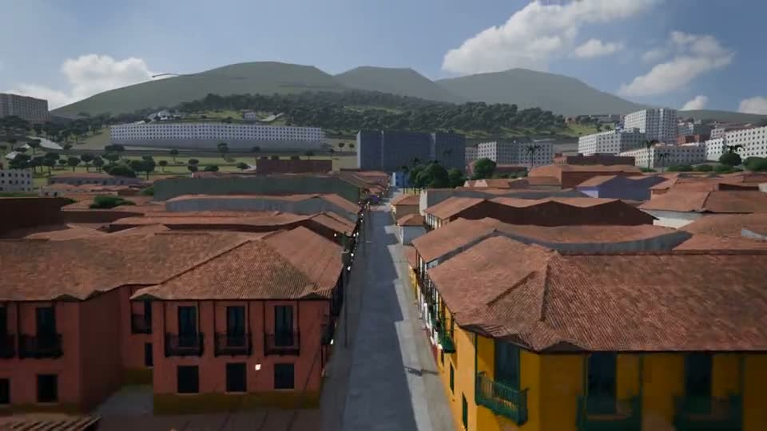

# La Candelaria in 3D

A procedural, realistic 3D model of four blocks of La Candelaria, the historic center of Bogotá (around the Chorro de Quevedo), generated in Blender from open map data, plus an animated drone flight over it.



## What it shows

Instead of modeling buildings by hand, Python scripts read real OpenStreetMap footprints and SRTM elevation, then rebuild the neighborhood inside Blender: colonial facades, roofs, streets, terrain, parks, trees and the wider city context, with a camera path that flies through it like a drone.

## How it works

1. **Fetch data** (`scripts/fetch_context.py`): downloads OpenStreetMap tiles from the OSM API and elevation grids from the OpenTopoData SRTM 30 m service.
2. **Preprocess** (`scripts/preprocess.py`, `scripts/preprocess_ctx.py`): converts the raw OSM XML into clean 2D geometry and terrain data in `data/*.json` (uses Shapely and NumPy).
3. **Build in Blender** (`scripts/build_all.py`): runs the build modules in order.
   - `cb_lib.py` shared helpers and terrain function
   - `cb_mats.py` materials (Poly Haven textures)
   - `cb_ground.py` terrain, streets and sidewalks
   - `cb_build.py` buildings, facades and roofs
   - `cb_extras.py` street details
   - `cb_context.py` the surrounding city, parks and forest
   - `cb_world.py` lighting, sky and render settings
   - `cb_anim.py` the drone camera path
4. **Render** (`render_video.ps1`): renders the frames with EEVEE and encodes an H.264 video with FFmpeg.

## Run it

Requirements: Blender 5.x, Python 3 with `numpy`, `shapely` and `scipy` for preprocessing, FFmpeg.

The processed data is already in `data/`, so you can skip straight to Blender. To rebuild it from scratch:

```bash
# 1. Export the core area from openstreetmap.org (Export > Manually select) as osm/candelaria.osm
# 2. Download the surrounding OSM tiles and SRTM elevation grids
python scripts/fetch_context.py osm data
# 3. Convert to Blender-ready geometry (<pylib> = folder where numpy/shapely/scipy are installed)
python scripts/preprocess.py osm/candelaria.osm data/elev.json data/scene.json <pylib>
python scripts/preprocess_ctx.py osm data <pylib>
```

Then save a `.blend` file in this folder, import the Poly Haven textures the materials expect, open `scripts/build_all.py` in Blender's Scripting tab and run it. The scripts find the project folder from the saved `.blend` (or from the `CANDELARIA_ROOT` environment variable).

```powershell
powershell -ExecutionPolicy Bypass -File render_video.ps1 -Blender "C:\Program Files\Blender Foundation\Blender 5.2\blender.exe"
```

The `.blend` file, raw OSM downloads and renders are not in the repository because of their size.

## Data credits

- Map data © [OpenStreetMap](https://www.openstreetmap.org/copyright) contributors, available under the Open Database License (ODbL). The files in `data/` are derived from it.
- Elevation: SRTM 30 m via [OpenTopoData](https://www.opentopodata.org).
- Textures: [Poly Haven](https://polyhaven.com) (CC0).

## License

Code: [MIT](LICENSE). Derived map data in `data/`: ODbL, as required by OpenStreetMap.
